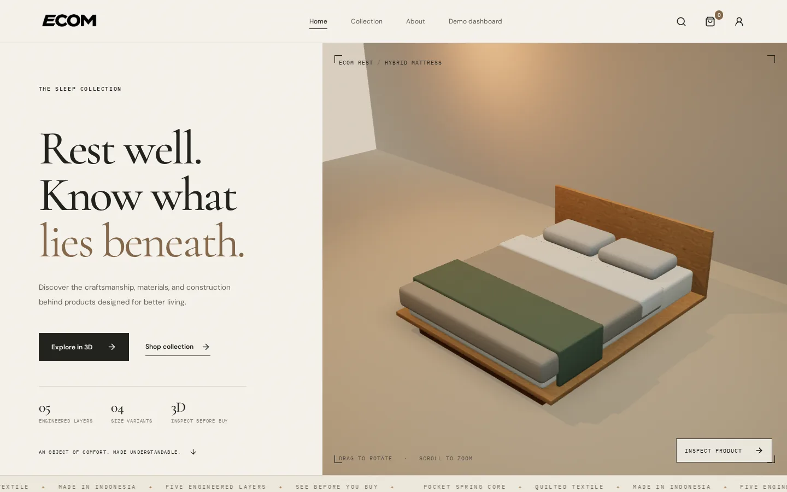
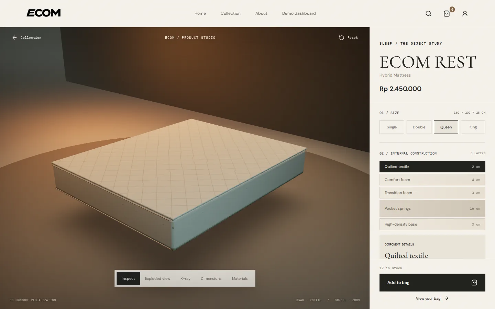
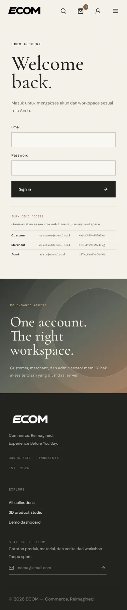

<div align="center">
  <a href="https://ee-ecom.vercel.app">
    <picture>
      <source media="(prefers-color-scheme: dark)" srcset="public/logos/ECOM-White.png">
      
    </picture>
  </a>

  <br><br>

  <strong>Commerce, reimagined through product understanding.</strong>
  <br>
  An editorial commerce prototype that turns product browsing into an interactive 3D experience.

  <br><br>

  <a href="https://ee-ecom.vercel.app">Live experience</a>
  &nbsp;·&nbsp;
  <a href="https://ee-ecom.vercel.app/studio/rest">3D studio</a>
  &nbsp;·&nbsp;
  <a href="https://ee-ecom.vercel.app/login">Role demo</a>
  &nbsp;·&nbsp;
  <a href="https://ee-ecom.vercel.app/admin/demo">Dashboard demo</a>

  <br><br>

  [](https://github.com/maksalarina12/ECOM/actions/workflows/deploy.yml)
  [](https://vitejs.dev)
  [](https://react.dev)
  [](https://threejs.org)
</div>

<br>



## The idea

ECOM is a showcase for a more transparent way to shop for designed objects. Instead of relying on a flat catalog image, customers can inspect construction, dimensions, materials, and interaction states before adding an item to their bag.

Built for the **Creative Hub for App Talent (CHAT) 2026 · Banda Aceh** hands-on vibe-coding showcase.

> **Live:** [ee-ecom.vercel.app](https://ee-ecom.vercel.app)

---

## Product studio

The core experience is an interactive 3D product studio. It is designed to communicate how an object is made, not only how it looks.



- Real-time, touch-enabled 3D product inspection
- Inspect, exploded, X-ray, dimension, and materials modes
- Five-layer hybrid mattress construction with interactive annotations
- Product variants, textile color choices, and live component selection
- Procedural 3D models for the complete furniture collection
- Adaptive rendering path for mobile GPUs: bounded DPR, reduced geometry, and lightweight shadows

---

## Built for every screen

ECOM is installable as a PWA and designed for touch-first browsing, including smooth 3D interaction on mobile devices.

<table>
  <tr>
    <td width="42%" valign="top">
      
    </td>
    <td valign="top">
      <h3>Mobile-ready by default</h3>
      <ul>
        <li>Installable web app for Android and iOS</li>
        <li>Offline app shell and cached 3D model after first load</li>
        <li>Safe-area-aware layout for standalone mode</li>
        <li>Touch-optimized orbit controls and responsive camera framing</li>
        <li>Role-based account access that works equally well on phone or desktop</li>
      </ul>
      <p><a href="https://ee-ecom.vercel.app/login">Open the role demo →</a></p>
    </td>
  </tr>
</table>

---

## What is included

| Area | Experience |
| --- | --- |
| **Storefront** | Editorial landing page, product collection, filters, search, sorting, product details, bag, and checkout flow. |
| **3D studio** | Eleven product models, cinematic lighting, camera controls, material construction, and responsive scene quality. |
| **Commerce** | Variant-aware pricing, cart persistence, checkout validation, order creation, and account order history. |
| **Role access** | Customer, merchant, and admin workspaces protected server-side—not only hidden in the interface. |
| **Merchant workspace** | Product management, order pipeline, stock monitoring, and order status changes. |
| **Admin workspace** | User list and role management, with protected API access. |
| **PWA** | Web manifest, service worker, icons, cached shell/assets, and offline navigation fallback. |

---

## Role model

| Role | Allowed actions |
| --- | --- |
| **Customer** | Browse, add items to bag, create orders, and view only their own order history. |
| **Merchant** | Access the merchant workspace and manage orders/products. |
| **Admin** | All merchant capabilities plus user and role management. |

The API validates the signed session and role for every protected request. A customer request to the admin user endpoint is rejected with `403`.

Temporary jury credentials can be presented from the live `/login` page through server-side environment variables. They are not committed to this repository or README. Rotate or disable them after evaluation.

--- 

## Architecture

```text
Browser / PWA
  ├─ React + TypeScript + Vite
  ├─ Three.js + React Three Fiber + Drei
  ├─ Zustand (local interface state and bag)
  └─ Vercel Functions (/api)
       ├─ Signed HttpOnly session cookie
       ├─ scrypt password verification
       ├─ server-side role authorization
       └─ private GitHub JSON store (demo persistence)
```

### Security decisions for the demo

- Passwords are saved as **scrypt hashes**; never as plaintext in the database.
- Sessions are signed and stored in **HttpOnly, Secure, SameSite=Strict** cookies.
- Authorization runs in the Vercel function, not in client-side route visibility alone.
- Database token and session secret live in **Vercel Environment Variables**—never `VITE_*` variables or Git.
- The demo data repository is private.

---

## Tech stack

- **Frontend:** React 19, TypeScript, Vite, React Router
- **3D:** Three.js, React Three Fiber, Drei
- **Interaction/state:** GSAP, Zustand
- **Backend:** Vercel Functions, GitHub Contents API (private demo store)
- **Quality:** Vitest, TypeScript checks, GitHub Actions

---

## Run locally

**Requirement:** Node.js 20+.

```bash
npm install
npm run dev
```

Open [http://localhost:5173](http://localhost:5173).

### Commands

```bash
npm run typecheck  # TypeScript verification
npm test           # Unit tests
npm run build      # Production build
npm run check      # Typecheck + tests + production build
npm run preview    # Serve production build locally
```

### Local API/auth

Copy `.env.example` to `.env.local`, fill in the server-side values, then run:

```bash
npx vercel dev
```

Never expose `DB_GITHUB_TOKEN` or `SESSION_SECRET` to the browser. Variables prefixed with `VITE_` are public by design.

---

## Project structure

```text
src/
  App.tsx               routes, storefront, checkout, dashboards
  auth.tsx              client auth context and role guard
  scenes/Scene.tsx      cinematic 3D scenes and mobile render path
  store/shop.ts         cart and local UI state
api/
  auth/                 login, logout, current session
  orders/               authenticated order read/write
  admin/                administrator-only user operations
server/
  auth.js               session and password primitives
  db.js                 private JSON-store adapter
public/
  models/               CC0 GLB asset
  products/             rendered 3D catalog thumbnails
  sw.js                 service worker
```

---

## Deployment

The production project is hosted on Vercel at [ee-ecom.vercel.app](https://ee-ecom.vercel.app). Every push to `main` runs the verification workflow before release.

For a new Vercel project, configure the following **server-side** environment variables:

```env
DB_REPO_OWNER=
DB_REPO_NAME=
DB_GITHUB_TOKEN=
SESSION_SECRET=
```

Then deploy:

```bash
vercel --prod
```

---

## Known demo boundaries

ECOM is a polished showcase, not a production payments platform.

- Product specifications, prices, inventory, and claims are illustrative.
- No payment capture, courier integration, tax calculation, or transactional email is connected.
- The private GitHub JSON store is suitable for a controlled demo, not concurrent production orders or inventory.
- A real launch should use a transactional database, payment gateway, object storage, audit logging, and merchant-level data isolation.

---

## Asset credit

The low-platform bed model is from the **Innerscene 3D Parts Library**, licensed **CC0**. See [ASSETS.md](./ASSETS.md) for details.

<div align="center">
  <br>
  <sub>Made for CHAT 2026 · Banda Aceh · Indonesia</sub>
</div>
